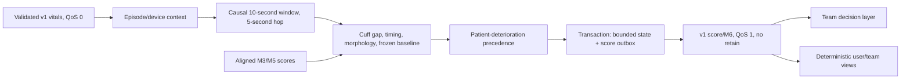

# Phase 3 implementation and integration handoff

M6 runs deterministically in Python 3.12 inside the existing service. No LLM or
additional agent framework is used for scoring or live display text. This is a
research implementation with a real-data acceptance gate still outstanding.

Version 0.3.1 adds an explicit cuff-gap-only path during incomplete baseline or
missing HR/timing, after all patient-review guards. It does not invent combined
evidence or deploy the offline trained forest. Stored older algorithm episodes
and calibration artifacts require reviewed replacement contexts/artifacts;
same-episode reuse is rejected. See [measured results and upgrade precautions](m6-revalidation-2026-10-09.md).

## Runtime architecture



`m6.py` owns the scorer. `m6_persistence.py` uses a transaction-scoped PostgreSQL
lock per bed, reads the stored episode, advances it and inserts the score into
the existing outbox in one transaction. Migration `0003_phase3_m6` is additive.
The MQTT worker retries from that outbox. QoS 1 may redeliver a message; consumers
deduplicate by bed, window_start, model/version. The local outbox key additionally
contains the opaque episode ID. Publication is not a claimed exactly-once
network-delivery guarantee.

## Research configuration

Apply all migrations and initialize the existing checkpointer first. Leave the
phone channel under the existing Phase 2 configuration. Enabling M6 does not
require Telegram credentials or enable live alert effects.

```powershell
$env:SENTINEL_M6_ENABLED = "true"
$env:SENTINEL_M6_CONTEXTS_FILE = "D:/protected-config/m6-contexts.json"
# Optional after validation:
$env:SENTINEL_M6_CALIBRATION_FILE = "D:/protected-config/m6-calibration.json"
uv run sentinelward db upgrade
uv run sentinelward serve
```

The context file uses the shape in `fixtures/m6-contexts.example.json`. The lead
supplies a new opaque episode ID, monitor ID and actual stream start timestamp
for each patient. Change the context and restart the service before a new
patient's first frame. A new context must have a later start time; changing
parameters inside a stored episode is rejected. Sequence regression and device
mismatch are dead-lettered for reconciliation. Only beds in the map are scored.
Never place names, identifiers or raw waveforms in shared reports or Git.

`test` and `demo` permit research M6; `design-real` rejects it until review.
Demo retains the existing TLS requirements. No new endpoint bypasses authentication.
Offline CLI tools need no database, bot token or `.env` credentials.

## Scoring behavior

- Frames are 125 Hz, exactly one second, with finite samples and whole-second
  timestamps. Missing channels are `null`. Future cuff readings are rejected.
- Windows start on multiples of 5000 ms and contain exactly ten sequential
  frames. Late frames do not revise published scores. Gaps yield insufficient
  data at the next received aligned boundary; complete silence is handled by
  the backend's freshness monitor, not an invented M6 heartbeat.
- The initial baseline uses 179 overlapping usable windows (900 seconds of
  coverage). It requires plausible HR, an ECG-to-PPG upstroke timing proxy and
  fresh cuff agreement. A frozen robustly centred ridge regression predicts
  MAP from HR, timing and arterial pulse amplitude. The timing extraction is
  a simple research proxy requiring review on real waveforms.
- Two-sided Page–Hinkley accumulates residuals against the fixed baseline.
  The evidence index combines gap/change and morphology. Initial research
  weights and thresholds are explicit, reproducible and unvalidated.
- Pulse attenuation is flagged as damping evidence; it is not proof that
  the sensor is faulty. Pressure fall, low ART, low cuff or a high monitor
  alarm take precedence and produce `emergency_compatible`, including when
  other drift inputs are unavailable. Conservative guards reduce sensitivity
  to negative sensor offsets; evaluate this tradeoff on real data.
- Default cuff freshness is 120 seconds. Expired/missing cuff produces
  `insufficient_data`. Normalizing absence to zero or normal is prohibited.
- Both M3 and M5 must already be present for the exact window to infer a cause
  hint: explicit `tampering` yields tampering; both `normal` yield sensor;
  missing, late or unrecognized labels yield uncertain. These peer-label
  semantics require Singhal's confirmation. No score alone proves intent.

## Locked output and display

Topic: `ward/bed/{bed_id}/score/M6`. Body: unchanged v1 `ScoreMessage`; QoS 1,
non-retained. Labels: `warming_up`, `stable`, `drift`, `insufficient_data`,
`emergency_compatible`. A score is an evidence index, not a probability.
`extra` preserves Phase 0 naming: `gap_mmhg`, `inputs_sufficient`, `shape`,
`page_hinkley`, `cause_hint`. Additional fields describe actual ART/cuff readings,
cuff age, baseline count, aligned peers, calibration/config hash and research
status. Missing measurements are omitted or explicitly false, never fabricated.

M6 does not send a phone alert or change a patient's verdict. Singhal's decision
layer combines its score with other models and publishes the verdict; A1 handles
that verdict. User/team lines are projected through `wire_output_views`; canonical
JSON stays complete for model/backend consumers. UI colors/icons remain Antra's
implementation; urgency is available as deterministic text and typed labels.

## Local VitalDB loader and replay

The loader follows the [official VitalDB CSV track format](https://vitaldb.net/docs/?documentId=API%2FWeb_API_OpenDataset.md)
and [track names](https://vitaldb.net/docs/?documentId=OpenDataset%2FOverview.md).
Supply already downloaded case-local CSV/gzip tracks and the example manifest.
It reads explicit numeric timestamps and compact waveform clocks; averages
500-Hz samples into 8-ms bins; refuses missing bins; retains sparse cuff events
and only holds scalar HR briefly. NIBP sys/dia/MAP must identify the same cuff
event. All case-relative times share an explicitly configured replay epoch.
ART numeric tracks can accompany the manifest for offline review; the runtime
MAP feature comes from the arterial waveform. No dataset is downloaded implicitly.

```powershell
uv run sentinelward m6 replay --manifest data/m6-case.json --view team
uv run sentinelward m6 replay --manifest data/m6-case.json --view model
uv run sentinelward m6 replay --input data/vitals.jsonl --context data/episode.json --view user
uv run sentinelward m6 demo --report D:/m6-synthetic-report.json
```

Replay emits one line per aligned score. User/team lines are <=160 characters;
model output is full compact JSON on one physical line. Invalid input yields a
short failure line and exit code 2. Output files are created exclusively and
existing experiment evidence is preserved.

## Calibration and frozen held-out evaluation

Create a split manifest with `dataset_id`, `source` (`synthetic` or `vitaldb`),
`labels_reviewed`, and nonempty disjoint `train`, `validation`, `test` patient-ID
lists. Never split adjacent windows from one patient across groups. The per-patient
warmup is separate from this dataset split; no population training claim is made.

Label each emitted score in JSONL with `patient_id`, `event_id`, `onset_ms`,
`truth` (`stable`, `drift`, `tampering`, `hypotension`) and `score` (full v1 JSON).
The reviewer supplies the truth and consistent event/onset labels. Validation
must include stable, drift and hypotension examples from every listed validation
patient. Repeated windows, wrong patients, inconsistent events, different scorer
versions/configuration and unaligned scores are rejected.

```powershell
uv run sentinelward m6 calibrate --split data/split.json --records data/validation.jsonl --output models/m6-calibration.json
uv run sentinelward m6 evaluate --artifact models/m6-calibration.json --records data/test.jsonl --report evidence/m6-heldout.json
```

Calibration chooses a threshold on validation only: highest drift recall with
zero hypotension false drift and <=1% stable-window false positives by default.
The limit is configurable and recorded. The frozen artifact includes the config,
patient split, record hash, threshold and an integrity hash. This hash detects
accidental edits; it is not a digital signature or an authorization mechanism.
The held-out CLI records a ledger beside the artifact and rejects repeated
evaluation. Copying the artifact can bypass a filesystem ledger; the team must
also enforce its experiment register and avoid tuning on held-out results.

The report includes sensitivity, false positives, cuff-gap comparator, cause
confusion, event delays, input coverage and the hypotension numerator/denominator
and patient count. Zero failures on a tiny set is reported with its one-sided
95% patient-level upper bound. Empty safety sets and synthetic labels leave the
real-data gate pending. Singhal's clinical and integration review is still required.

## Next handoff inputs

The lead supplies the broker ACL for QoS 0 vitals and QoS 1 M6 scores, timestamps,
episode lifecycle and verified monitor mapping. Singhal supplies patient splits,
reviewed hypotension labels, M3/M5 label semantics and decision-layer integration.
Kartik supplies independent slow malicious-drift and fault fixtures. Aditya's
code accepts those inputs through the documented files and v1 wire without a
contract redesign. Live LinuxONE throughput and platform testing remain pending.
