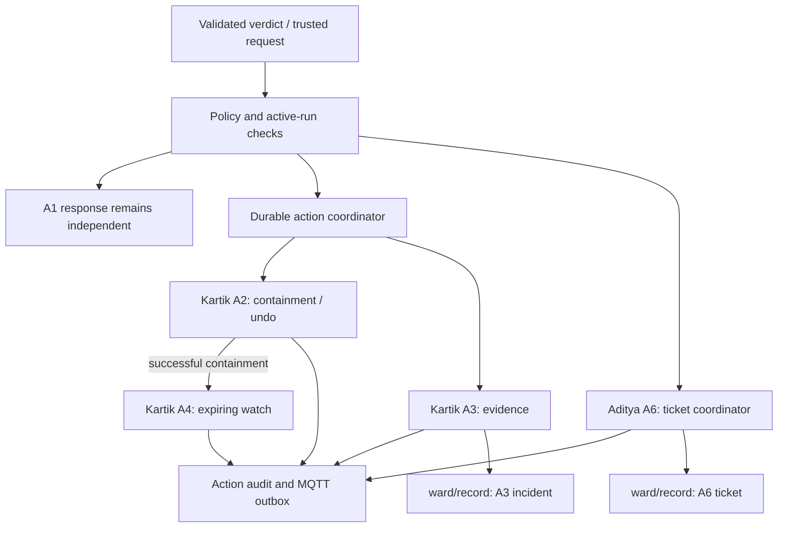

# Phase 4 implementation plan: A2–A4 integration and A6

Status: implemented locally on `phase/4-agent-integration`, from published checkpoint `905235d`. The revised decisions below supersede the initial hosting-only plan. See [integration contracts](phase-4-integration-contracts.md), [runbook](phase-4-runbook.md), and [verification report](phase-4-verification.md). Source review remains the historical planning baseline.

## Revised decisions confirmed by Aditya

- Implement replaceable local A2–A4 handlers rather than waiting for teammate source.
- Complete isolated integration with real local Mosquitto/PostgreSQL and a labelled backend reference. Deployed team integration is a separate acceptance gate.
- Containment policy is explicit/configurable. Fixture thresholds are not approved production policy; automatic deployed containment remains disabled without approval.
- One unresolved biomed ticket per device merges different faults. Only NORMAL ends a fault episode; three loose episode starts in `(t-30 minutes,t]` trigger a ticket.
- Reset preserves isolation. A valid new isolated run restores only harness-owned broker accounts; production reconnection requires authorized IT undo.
- Network evidence uses real broker-message transcripts; raw PCAP is an explicit deployment dependency.
- Local A1 screen alerts are real/persisted, with an explicitly unavailable Telegram backup in the lab profile. Alert reset is scoped by internal demo identity.
- Isolate/undo and workflow/control use a lifecycle gate to prevent an in-flight old workflow from entering the next run.
- A2/A4/A6 state-changing undo is owner-resolved and append-only. Evidence/read-only operations are retained rather than pretending they can be erased.

The sections below preserve the initial work-package rationale. Where they require waiting for Kartik/backend agreement, the local interfaces/reference implementation now satisfy the local gate; deployed owner acceptance remains external. They do not authorize modifying teammate systems or publishing changes.

## Outcome and scope

Host Kartik's containment, evidence, and fleet-watch handlers inside the existing agent engine, and implement Aditya's biomed-ticket coordinator. A valid attack decision must preserve the nurse/emergency response, perform only approved containment, publish truthful action/evidence state, and support authorized idempotent undo. A DRIFTING decision must open/update one biomed ticket; three distinct loose-sensor occurrences in 30 minutes must do the same.

Phase 3's local M6 work is complete. Its external acceptance items remain tracked and do not require reopening M6 research to begin Phase 4. This plan does not claim clinical acceptance or a fully connected demo.

In scope:

- Typed internal interfaces, handler registry, safe configuration, and fixtures for A2/A3/A4.
- Correct verdict routing, independent failure handling, durable effect/recovery state, IT approval and undo coordination.
- Action publisher/outbox integration and incident/ticket record integration.
- Evidence completion/hash verification and one-hour fleet-watch expiry.
- Durable A6 triggers, episode counting, ticket merging, biomed closure boundary, issue history and deterministic output.
- Run/reset/stale-event integration for state introduced by Phase 4, plus the known A1 timer-reset carryover.
- Unit, contract, PostgreSQL restart/failure, and connected-team acceptance tests.

Excluded: M6/C1 changes; model training/calibration; changing M4/M5 detection thresholds without model-owner policy; writing Kartik's broker/evidence internals; implementing lead-owned public APIs or Antara's screens; A5/A7/A8/Granite runtime work; A9; cloud workflow services; deployment or automatic report sending.

## Fixed requirements

1. Production M6 remains `m6-research-0.3.4`; its source hash must match the Phase 3 checkpoint after all checks.
2. C1 stays isolated. A6 acts on validated decision-layer verdicts, never directly on a raw M6 score, missing input, warming-up label, or offline completion.
3. BOTH preserves A1's high-priority emergency path. A2/A3/A4 failure cannot delay, cancel, close, or downgrade that path.
4. No action touches treatment or sends commands to a bedside monitor. Broker control is delegated exclusively to Kartik's A2 adapter.
5. A4 can watch peers; it cannot isolate them. A6 creates maintenance work; it cannot execute clinical adjustments.
6. Every material action/result is durable and represented on `ward/action`; unknown effects remain unknown until reconciled.
7. Identity, role and approval come from trusted context. A payload note, device name or Granite string cannot grant authority.
8. Missing facts remain missing. User/team outputs remain deterministic, one line <=160 characters; canonical machine JSON retains full fields. Urgent text retains explicit urgency.
9. Untrusted and offline are different lifecycle states. Both retain the appropriate last readings. Known source completion cannot create an attack, ticket or timer-generated model alert.
10. Reset clears active run memory/jobs/queues without deleting historical actions, tickets, incidents, evidence, or audit records. Safety handling for isolated broker accounts must be agreed with Kartik; reset cannot silently grant unauthorized access.

## Ownership and immediate handoffs

| Owner | Responsibility | Exact input/output needed |
| --- | --- | --- |
| Aditya, this repository | Central engine, typed dispatch, authorization, durable action/undo tracking, A6, operational output, local tests and reset coordination | Fixture-backed interfaces, migration and contracts, integration test pack. |
| Kartik | A2 disable/enable + persistent-session cleanup; A3 immutable snapshot/hash/timeline; A4 same-model lookup/watch mechanism | Callable handlers or versioned service interface; result/error/state-query semantics; capability manifest; evidence paths/manifest; watch expiry and reset behavior. |
| Aditya Singhal | Verdict producer and model/decision policy | Eight valid verdict fixtures, approved containment policy with threshold/version/boundary cases; watch-mode handling owned by M4/M5/decision. |
| Aditya Singh, lead/backend | Protected actor-role context; inventory; bed trust projection; record upsert/edit; public APIs/WebSocket; simulator/control/deployment | Auth method, inventory fields and device/client mapping, reliable request lookup/authorization, run binding, ticket status feedback, live endpoint/broker evidence. |
| Antara | S6/S7/S9/S11 presentation and permitted controls | Show pending/failed/unknown/isolated/undone, evidence incompleteness, ticket updates and actor; keep last values; submit locked requests through backend. |

Do not wait for all live services to start local work. Build the hosting/records/ticket path against deterministic doubles. Mark each live handler unavailable until its owner supplies it; a simulated success must never be presented as real isolation or real evidence completion.

## Architecture and trigger matrix

Keep LangGraph, the PostgreSQL checkpointer, existing reservations/audit/outbox, Pydantic contracts and the MQTT adapter. Extend them; do not introduce a second workflow framework.

| Trigger | Planned behavior |
| --- | --- |
| NORMAL | No new containment/ticket; may end a fault occurrence using the agreed boundary. Never auto-close an unacknowledged high alert or biomed ticket. |
| EMERGENCY | Existing A1 path; no automatic device containment from this verdict alone. |
| BOTH | Existing high A1 response immediately; threshold-gated A2; A3 evidence regardless of A2 outcome; A4 only after confirmed containment. |
| TAMPERING | Existing A1 bedside hand-check; A3 evidence; add approved threshold-gated A2; A4 after confirmed containment. |
| UNSURE | Existing A1 hand-check; no auto-isolation or maintenance ticket. |
| DRIFTING | Existing A1 bedside review; A6 creates/updates biomed ticket immediately. |
| LOOSE_SENSOR | Existing A1 refit response; A6 records a distinct occurrence and creates/updates ticket at the agreed three-in-30-minute gate. |
| DEVICE_ATTACK | A3/IT handling; no nurse-facing alert solely for network-only evidence. No A2/A4 expansion without approved decision policy. |
| isolate_device request | Resolve actor role and device/client/bed; dispatch A2 through the same coordinator; retain `approved_by=by`. |
| undo_action request | Resolve original stored action and owning agent; verify role, active scope and allowed compensation; dispatch once; append a new action linked with `undoes`. |

## Ordered work packages

### P4-0 — Declare integration contracts and fixtures

Deliver `docs/phase-4-integration-contracts.md` and `fixtures/phase4/` before live wiring. Record protocol/version, owner, capabilities, required data, timeout, retry/reconciliation, cancellation, reset and error behavior for each handler. These are internal proposals; locked MQTT fields/topics remain unchanged.

Proposed internal handler result requirements: attempted action and stable identity, disposition (success/rejected/failed/unknown), independently confirmed substep outcomes, external references, compensation availability, and sanitized reason. Reuse `ActionResult` where adequate; do not overload a single success flag for disable/session-cleanup/projection completion.

Resolve or record blockers for: containment threshold/operator; actor-role lookup; concrete client mapping and session cleanup; incident/episode boundaries; evidence lookback/retention; same-model versus firmware filtering; one-hour watch policy; ticket data/status vocabulary and edit feedback; run binding and retained-verdict behavior; compensation policy.

Acceptance: every owner can implement its adapter against a fixture without rediscovering an envelope, and no privileged operation is authorized merely by request text. Unresolved live fields are explicitly unavailable, not fabricated.

### P4-1 — Extend durable engine, action publishing and recovery

Change surfaces: `ports.py`, `engine.py`, `router.py`, `service.py`, `policy.py`, `cli.py`, `config.py`, `persistence.py`; proposed new `agent_dispatch.py`, `agent_lifecycle.py`, `adapters/action_publisher.py` and a versioned phase-4 migration.

- Register A2/A3/A4 handlers explicitly; keep simulate mode explicit and live mode deny-by-default.
- Correct routing omissions from the trigger matrix. Preserve A1 behavior and ensure non-A1 exceptions cannot suppress or roll back emergency publication.
- Persist business/episode identity in addition to five-second ingress identity, preventing repeated verdict windows from creating repeated material effects.
- Recover reservations by stored status/step, not solely whether a reservation already exists. Query/reconcile uncertain external state before retrying a potentially completed side effect.
- Publish canonical action outcomes through the outbox. Record failures and unknowns truthfully; validate audit/result/undo linkage.
- Bind trusted request authorization and original-action lookup to the centralized coordinator. No direct request-to-broker bypass.
- Reuse the existing undo-links uniqueness constraint; implement durable claiming/resumption and state queries. Do not promise mathematically exactly-once distributed execution: demonstrate one observed effect under duplicate/restart cases using idempotent adapters and reconciliation.

Acceptance: malformed/forged requests are rejected; duplicate windows do not repeat effects; crashes before/after reservation or effect recover honestly; A1 remains live despite handler failure; canonical action schema and <=160-character views pass.

### P4-2 — Containment and IT-only undo adapter integration

Aditya owns workflow/state/authorization tests; Kartik owns actual broker operations.

Track disable, session cleanup and untrusted projection separately. Do not claim fully isolated until required broker operations are confirmed. On partial failure, preserve known successful state, mark incomplete/failed/unknown work, keep bedside and IT visibility, and retry only reconciled safe steps.

Use actual inventory/client mapping, not an unchecked bed-derived client identifier. Preserve last trusted readings and their age; backend owns projection. A nurse's Patient OK confirmation does not enable the broker client. Undo verifies IT role and original owner, executes the allowed enable/compensation once, creates a fresh action with `undoes` and `approved_by`, and must not declare current data trusted merely because enable succeeded. Restoration of trust requires backend/decision evidence.

Acceptance: duplicate TAMPERING/BOTH/request delivery has one observed containment; unapproved/unauthorized paths have none; repeated undo has one observed enable and one durable link; restart and ambiguous broker response are reconciled; unavailable control never becomes `result=ok`.

### P4-3 — Evidence completion and fleet-watch integration

A3: agree snapshot timing so evidence is not lost by session cleanup. Kartik supplies immutable artifacts and manifest containing exact hash/size/time/source references. Local integration validates the manifest, checks SHA-256 where artifacts are accessible, and publishes typed `ward/record` incident data with an `evidence` list. Missing capture, failed hash, or inaccessible artifact stays pending/incomplete/failed/unknown; metadata alone cannot certify a hash. Preserve the timeline and distinguish attack-script events, observed verdicts, actions and acknowledgements. Freeze an initial evidence boundary; append later timeline observations without rewriting source artifacts.

A4: trigger from confirmed A2 containment, look up same-model peers with explicit firmware policy, request the approved watch mode, and persist activation/expiry at 60 minutes. Repeated triggers and expiry restore only this workflow's change; they cannot overwrite other active watch policies. Restore after process restart, clear/compensate on demo reset according to owner agreement. Kartik/model owners apply watch policy; Aditya's engine does not silently tune model thresholds. A4 has no isolation capability.

Acceptance: evidence hashes re-check against actual files and timeline ordering matches audit; a corrupted/missing file prevents complete state; A4 targets only agreed peers, expires after one hour with controlled time, resumes after restart, and never calls disable_client.

### P4-4 — Implement A6 biomed ticket coordinator

Proposed files: `tickets.py`, `ticket_persistence.py`, plus typed ticket data in `contracts.py` or a dedicated internal-contract module. Use existing `MqttRecordPublisher` and add durable ticket/fault occurrence state as required.

Declared proposed semantics to lock before implementation:

- DRIFTING starts or updates a ticket for that device and problem family immediately; do not wait for a new M6 baseline or rescore inputs.
- A loose-sensor occurrence is entry into a new contiguous fault episode, not every five-second repeat. It ends on a valid non-loose observation under the agreed continuity boundary. Missing data/offline is not recovery. Duplicates/out-of-order observations do not create occurrences.
- Count three distinct episode starts in an event-time trailing 30-minute interval; test exact endpoint inclusion and confirm the rule in P4-0. Never invent missing historical occurrences.
- Maintain one unresolved ticket per device/problem family within the active scope. Repeated observations update the same `record_id`; escalation from loose to drift and device/bed reassignment require explicit agreed rules.
- Issue-history counters use distinct events in the previous 30 days and distinguish synthetic/demo history. Do not count each replay as real equipment history.
- Store bed/device, problem, source verdict/time, evidence availability, recommended human maintenance review, occurrence count, first/last occurrence, status and revision in proposed `data`. They become shared data fields only after backend/UI agreement.
- Ticket rendering offers the reviewed maintenance suggestion as a biomed task, never an executable action. Missing gap magnitude/duration remains absent rather than copied from an example.
- Backend owns `GET /api/tickets` and biomed `PATCH /api/tickets/<id>`. Agree a protected feedback/read path so closed tickets cannot be silently reopened/overwritten by an old producer revision.
- NORMAL/drift cessation does not close the ticket. A biomed engineer closes it. A later genuine new fault can create a new ticket per the declared rule.

Acceptance: first DRIFTING yields one persisted ticket; 2 loose episodes yield none, 3 in-window yield one; a continuous 30-minute loose verdict yields one occurrence; repeats merge; concurrent delivery/restart gives one ticket identity; closure and delayed updates preserve biomed state.

### P4-5 — Agent lifecycle and connected acceptance

Add a coordinator for active agent state/timers distinct from M6 state. Clear A6 occurrence buffers, pending run-scoped jobs and A4 watch timers safely; preserve records/evidence/history. Retire A1 old-demo live timers with an explicit reset hook. Kartik must specify safe containment/reset compensation; reset cannot blindly enable every account. Replayed old requests/verdicts/actions must not repopulate current-run state. Resolve the missing wire run/role metadata through P4-0's trusted boundary, not by changing locked envelopes silently.

Run fixture integration locally, then the [team smoke test](demo-v1.1-team-smoke-test.md) with real owners. Test B05-style tampering/undo, B07-style BOTH, B08 ticket and B11 network-only handling using deterministic verdict fixtures first. Recorded ward-script expectations are targets, not proof those model outputs are already achieved.

Acceptance: reset -> run A -> activity -> source completion -> reset -> run B has no active prior state, alerts from silence, or old-run effects. Last values/audit remain. Real broker/API/UI evidence must close live gates.

## Work schedule and management

The original Phase 4 two-hour slot is a team integration checkpoint. It is not a credible estimate for all new durable workflows from the current code. Working estimate: 12–20 focused local engineering hours plus 2–4 hours of joint integration, excluding waiting for teammate handlers/access. Refine after P4-0; do not guarantee completion against unavailable services.

| Milestone | Order | Estimate | Gate |
| --- | --- | ---: | --- |
| P4-0 contracts/fixtures | First | 1–2 h | Declared local behavior; live unknowns assigned. |
| P4-1 durable engine/action/approval | After contracts | 3–5 h | Recovery, permission and independent A1 tests pass. |
| P4-2 A2/undo | After P4-1; live waits on Kartik/backend | 2–3 h | Truthful containment + authorized one-effect undo. |
| P4-3 A3/A4 hosting | After shared interfaces | 2–3 h | Manifest/hash and expiry tests pass. |
| P4-4 A6 | After shared interfaces | 2–4 h | Ticket triggers/merging/status tests pass. |
| P4-5 lifecycle/local regression | After workflows | 2–3 h | Agent reset/restart and regression gates pass. |
| Joint team acceptance | After live dependencies | 2–4 h | Captured broker, DB, API and UI evidence. |

Estimates overlap shared test work; per-row totals are approximate. A6 can be implemented alongside fixture A2–A4 work after contracts stabilize, without requiring live broker access. Prefer small reviewable commits: contracts; durable dispatch; A2/undo; evidence/watch; A6; lifecycle; final evidence. Create a dedicated `phase/4-agent-integration` branch when implementation begins from the verified checkpoint. Do not merge or deploy without the user's instruction.

Track each work item as TODO, IN_PROGRESS, BLOCKED(owner), LOCAL_VERIFIED, or LIVE_VERIFIED. Record the evidence path and last tested commit. Never mark a simulated test LIVE_VERIFIED. End each milestone with a concise owner/status/blocker update; do not message teammates automatically.

## Validation matrix

| Case | Required observable result |
| --- | --- |
| All eight canonical verdicts | Match the declared routing matrix; preserve DEVICE_ATTACK's IT-only behavior. |
| BOTH + broker timeout/evidence exception | A1 high alert/ladder remains; failed/unknown security substeps visible. |
| Threshold missing, below, equal, above | Approved comparator only; missing policy cannot isolate. |
| Unauthorized/mismatched actor or original owner | No privileged effect; rejection audit; no approved_by spoof. |
| Duplicate/concurrent requests and five-second repeats | One business effect/ticket; durable identities retained. |
| Crash before reservation / after reservation / after effect / before publish | Honest stored status, reconciled recovery, one observed effect. |
| Undo twice / process restart during undo | One durable undo link and observed compensation; append-only history. |
| Corrupted/missing evidence / partial snapshot | No false complete incident; exact missing artifact/reason shown. |
| Watch expiry/restart/overlapping watches | Approved peers only; correct one-hour expiry; no unrelated policy restoration. |
| Loose-sensor continuity and 30-minute endpoints | Distinct episodes counted; repeated windows not counted as separate faults. |
| Ticket closure/new fault/delayed revision | Biomed closure preserved; declared new-ticket rule; stale revision rejected. |
| Offline completion and silence | No synthetic model output, attack or maintenance ticket from silence. |
| Reset with active A1/A4/A6 state + delayed old event | Active timers/state retired; audit retained; old event cannot mutate new run. |
| Injected instruction in device/name/note | Treated as data; no new action or privilege. |
| Output rendering | One deterministic physical line <=160 chars, full canonical JSON and explicit urgency. |

Run the exact current CI commands: `uv sync --frozen --extra dev`, `uv run ruff check .`, `uv run ruff format --check .`, `uv run mypy`, migrations, checkpointer initialization, and `uv run pytest --cov=sentinelward --cov-report=term-missing`. Run the verified Python 3.12 environment with existing VitalDB/scikit-learn availability for the complete local regression. Report collected/pass/fail/skip counts and skip reasons; compare against the 155-test checkpoint without inventing a target count. Verify M6/C1 hashes and run `git diff --check` after the final edit and before any push.

## Rollout and definition of done

Keep new external adapters disabled by default; fixture mode remains labelled. Apply additive migration to a disposable database and test restart first. Enable live capabilities individually only after contract and credential tests. On failure, disable the affected capability and preserve action state for reconciliation; never silently fall back to a simulated successful isolation. Do not automatically reconnect isolated clients during application rollback.

Local Phase 4 is complete when hosting, A6, authorization/undo, recovery, records, evidence/watch and lifecycle tests pass, outputs are truthful, and production M6/C1 are unchanged. Missing real Kartik/backend services are named live blockers, not reasons to abandon A6 or central hosting.

Integrated Phase 4 is complete only when real TAMPERING/BOTH scenarios preserve nurse alerting, isolate the approved broker identity, retain last trusted values, store re-verifiable evidence, perform one authorized undo, expire watch state, and show one merged drift/loose ticket on the biomed board. All actions, approvals and compensation links must be visible in MQTT, DB and UI evidence. Phase 5 then begins with stable incident/ticket interfaces; no clinical or full-demo acceptance is inferred from local fixtures alone.
