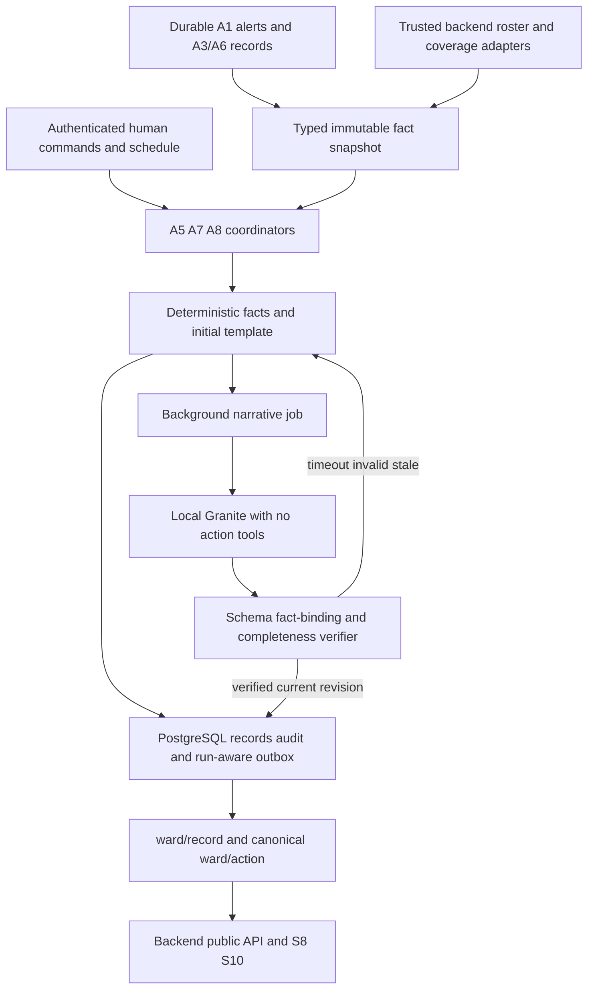

# Phase 5 implementation plan — A5, A7, A8 and narrative generation

Status: **FINAL USER-APPROVED PLAN — implemented locally on `phase/5-narrative-agents`; verification and external gates are tracked separately**. Baseline `e01e090` on `phase/4-agent-integration`. Based on the [source review](phase-5-source-review.md), Drive/website references and [Phase 4 completion](phase-4-verification.md). See [verification](phase-5-verification.md) for measured results and limitations; optional Granite generation is not considered accepted merely because templates work.

## Outcome and boundaries

Deliver durable report drafts, workload warnings and shift briefings using actual project records. Granite contributes bounded narrative composition; Python owns facts, arithmetic, policy, authority, timestamps, identifiers, urgency and workflow state. A1–A4/A6 and production M6 remain the tested reference.

Local completion includes deterministic behavior, real PostgreSQL/broker integration, PDF export, actual local Granite evaluation and a labelled backend reference. Deployed backend/screens, staff/source contracts and LinuxONE acceptance remain separately evidenced. A usable template result may complete a workflow during an outage, but does not count as successful Granite generation.

Excluded: M6/C1 changes, training, calibration, model-threshold changes, treatment commands, automatic report transmission, automatic nurse reassignment, A9, compulsory n8n/cloud services, teammate-system edits, push/merge/deployment. All human/team operational views remain deterministic, one physical line <=160 characters. Longer prose is confined to report/briefing documents, with structured machine facts retained.

## Accepted user decisions

The following choices were accepted before implementation. Team-owned deployed contracts remain external acceptance items.

| Decision | Accepted choice |
| --- | --- |
| Narrative | Fact-linked controlled sentences with code-inserted values and immediate template fallback. Freer prose, if requested, remains an explicitly unverified human-review draft. |
| A7 counting | One distinct A1 alert per nurse at first screen routing; new escalation recipient counts once. Retries/edits/acknowledgements and Telegram backup do not add another count. Label routing versus confirmed delivery. |
| A8 schedule | Explicit configured shift boundaries/timezone, plus on-demand. Lab scope is current run, with T+19:00 scheduled demo briefing. |
| A5 trigger and clock | Authenticated IT confirmation requests drafting. Notice timestamp is separate, with a labelled provisional observation anchor until reviewed. Six-hour countdown must not restart at confirmation/regeneration. |
| Metrics | Use measured source receipts or explicit unavailable/partial coverage. Collect trust intervals forward; no invented suppression counts or healthy zeros. |
| Model acceptance | Require real local Granite evidence for A5/A8 and report template fallbacks separately. LinuxONE acceptance requires its own measurements. |
| Partial human submission | Permit an exact-revision, reviewed, human attestation acknowledging every missing field and follow-up. Never claim verified delivery/receipt. |
| Generation budget | Scheduled demo output is an immediate template with at most 45 seconds for refinement. Ordinary jobs have a total 120-second deadline; one worker, queue eight. |

Routine choices below describe the approved implementation design. [Actual typed contracts and API paths](phase-5-contracts.md) take precedence over illustrative pseudocode. Shared staff, metric, report-template and human-command contracts require team acceptance before deployed use.

## Architecture



Generation never holds the lifecycle gate or database transaction while calling the model. Snapshot/reserve briefly, release, generate, then compare run/activity/source revision before committing. Reset cancels/retires old jobs; a late completion cannot publish into a new run. Use the existing one-worker/scheduler-leader topology, durable pending jobs and idempotent recovery.

## Fact layer: build this first

`FactSnapshot` contains schema version, snapshot ID/hash, run/shift/scope, interval bounds, as-of time, source watermarks/revisions and typed facts. Each fact carries predicate, subject, value/unit, status, source record/path/revision and relevant time range. Separate observed, derived, human-attested, unavailable and contradictory facts. Hash canonical JSON; no live mutable dictionary references.

Sources:

- A1 durable alert history, first recipient-routing facts, role/roster-at-event and delivery status.
- A3 incident IDs, observed timeline events, real artifact hashes and completeness. Attack-script future/oracle events are not runtime evidence.
- A6 current and historical ticket revisions/status, preserving human closure.
- Backend device/report profile, staff/charge-nurse roster, shift configuration and trust/coverage intervals.
- Decision-owner suppression receipts, if supplied; otherwise mark the metric unavailable.

Query interval semantics are declared per metric. A7 uses `(as_of-2h,as_of]`; briefing event aggregation uses `[since,as_of)`. Clip duration intervals to the requested interval, union overlaps per bed and never add overlapping blind periods twice. Use UTC epoch milliseconds internally; timezone is only for schedule boundaries and display. Restrict `since/as_of` to authorized scope and available history; cap query sizes and expose partial coverage.

Known zero requires complete coverage of that metric. No rows with incomplete coverage yields unavailable/partial, not zero. Contradictory revisions or source corruption prevent unsupported facts from entering prose.

## A5 — report drafting and human workflow

1. Trusted IT confirms an A3 incident using an idempotent internal command. Preserve incident/run/actor and separate occurred, first-observed, noticed and confirmed times. Unknown occurred time stays unknown. Human corrections are audited and invalidate approvals; an earlier notice anchor brings the deadline forward. A later correction requires explicit provenance and review, not an automatic clock reset.
2. Map a pinned CERT-In form plus project supplemental fields. Include reporter role/contact/organisation/address; affected entity; sector; occurred/noticed times; incident category with confirmation status; mission-critical status; IP/hostname/OS/patch/vendor/model/location; observed symptoms; actions with actual result; evidence references. Static Health/mission-critical defaults require a declared profile; do not guess a reporter, address, patch date or diagnosis.
3. Every field has value or null, status, provenance and missing/conflict reason. Show completeness/checklist without claiming legal compliance. Missing context in A3 remains missing in the report.
4. `deadline_ts=reviewed_noticed_ts+6h`; provisional deadline is explicitly marked until the anchor is reviewed. Persist clock state and derive remaining time from the timestamp. Restart, rerender and new evidence do not add six hours. No need to publish a record every second; backend renders the countdown from its anchor.
5. Save an initial template draft, then request Granite only for description/symptoms narrative. Completed/failing/unknown containment is represented truthfully; never claim prevented harm or verified attack solely from a verdict.
6. Trusted IT edits use `expected_revision`. Store authored fields separately from generated fields; regeneration cannot overwrite human text or sent revisions. Any material edit resets the revision-bound checklist/approval.
7. Generate a PDF from the validated current revision using ReportLab, with DRAFT/DEMO watermark, source/provenance, missing-field text markers, generation timestamp and document hash. Escape text; no fetching URLs or embedded active content. Download remains possible for an incomplete draft.
8. Human mark-sent records actor, attestation timestamp, exact revision/hash and reviewed checklist. It does not email, upload, notify CERT-In, or certify receipt. It uses the already permitted human `mark_report_sent` action, not an A5 send capability. Missing fields are visible. CERT-In FAQ Q30 permits available information with later follow-up; propose an explicit human partial-submission attestation and follow-up list rather than blocking all timely reporting or pretending completeness. Backend/Antara must accept this as a clarification of the S8 checklist, not a silent relaxation of role/review checks.

State vocabulary: draft, needs_review, ready_for_human_send, human_marked_sent; completeness and deadline state are separate. An overdue draft stays overdue. No automated legal classification or Granite-generated legal note. Pin the project's DPDP note only after primary-source verification; do not hardcode a time-sensitive conclusion as model output.

## A7 — workload warnings

- Aggregate every minute, with stable run/interval identity and an explicit `>40` comparator: 40 does not warn, 41 does. This is the documented prototype policy, not a universally validated clinical staffing limit.
- Recommended event identity `(run_id,alert_id,staff_id)` at first routing to that nurse. Escalation to another nurse adds that nurse once. Status edits, acknowledgements, retries and phone backup are not new alarms. Snapshot staff role/assignment at event time; do not reinterpret old routing with today's roster.
- Preserve source and channel status. A screen-routed event is not proof of physical delivery/read. Missing roster/recipient roles produce unassigned/unknown counts; do not guess nurse identities or count doctors as nurses.
- Publish per-nurse count, interval, coverage, threshold/comparator, overload state and charge-nurse notification status. Warn once on entering overload, with durable recovery and a cleared state when count drops; reminders, if any, require a separately declared policy.
- Charge nurse comes from an authenticated roster adapter, not a hardcoded name. Main channel is screen; phone is optional backup using the existing trusted messaging architecture.
- Candidate assistance is informational only: list comparable on-duty nurses and their measured load if source completeness permits it. Do not choose a transfer or write assignment state. Unknown staffing/skills/availability means no recommendation to move a bed.
- Keep rule/count output deterministic. Granite is not needed for thresholding or A7 warning text.

## A8 — shift and on-demand briefing

- Trigger at configured shift end or authenticated Generate now; in lab, a declared T+19:00 current-run briefing. No hidden preload of two-hour/whole-shift history.
- Gather incidents in interval, current untrusted/offline beds, ticket event counts and currently open tickets as distinct facts, relevant pending/failed/unknown actions, acknowledgement facts where available, Blind Time and explicit suppression metrics.
- Blind Time requires a versioned coverage ledger. Track measured no-trusted-data intervals with reasons; separate untrusted, source-offline, gaps and unknown coverage. Never declare all unseen history blind or healthy. Before admission and after documented source completion have explicit lifecycle coverage semantics, not inferred physiology. Report measured durations plus coverage/unknown duration; method and exclusions are visible.
- “Alarms stopped” requires a deduplicated suppression receipt linking an actual alarm to a reviewed decision. Publish “recorded suppressed alarms” with provenance, not proven false alarms avoided. No receipt means unavailable. No counterfactual without-system benefit claim.
- Include mandatory sections for active urgent state and unfinished handoff tasks. Urgent section is rendered directly from current verified A1/decision state before any Granite content; model omission cannot remove it. No new clinical advice, diagnosis, intent attribution or certainty.
- Save structured facts and deterministic summary first. Optionally revise narrative asynchronously. Each document carries since/as_of, run/shift, snapshot hash, coverage, version, provenance and revision. Do not alter source incidents/tickets while briefing.
- Human/team status line <=160 characters; short document target 100–180 words excluding the structured fact appendix. This is a proposed presentation budget, not an existing locked field.

## Granite — focused narrative design

Reuse the existing local Granite 3.3 2B artifact through pinned llama.cpp build 11433/`50569eb87`. No cloud endpoint, training, model swap or accelerator claim is needed. Verify local GGUF hash, byte order, chat template and capability probe before the real-model acceptance run. LinuxONE uses its separately verified big-endian artifact/build and actual resource budget.

Recommended trustworthy output is a typed composition plan, not arbitrary prose with a numeric-token filter:

```json
{
  "v": 1,
  "sentences": [{"phrase_id": "count", "fact_id": "f0", "wording": "concise"}]
}
```

Granite selects ordering and reviewed wording variants from facts; code inserts values. The job binds the composition to its stored snapshot. The implemented recovery uses only fact count and predicate-kind codes in the prompt; code supplies opaque fact IDs and predicates when expanding the compact selection. Patient values, notes and contacts do not enter prompts. Approved phrase definitions constrain predicate, role, tense, uncertainty and unit. Literal invented numbers, identifiers, unapproved clauses and unknown references are forbidden. This is controlled fact-linked narrative, not a claim that free-form semantic truth can be guaranteed. See the [recovery plan and evidence](phase-5-granite-recovery-plan.md) for the versioned model-only representation and strict full-workflow gate.

Verifier checks:

1. Strict JSON schema, supported version, bounded lengths, known snapshot and section/phrase identifiers.
2. Every binding matches its required predicate, entity, unit, source revision and time scope. Matching a number that belongs to another bed is a failure.
3. Missing/uncertain facts retain their qualifiers. No conversion of suspected to confirmed, pending to successful, absent to zero, or offline to attack.
4. Required urgent, incomplete-evidence, unresolved-action and human-send statements cannot be omitted. Reject conflicting or unsupported claims.
5. Final rendered numbers/units/times/IDs trace back to the corresponding facts, with declared rounding. Check words such as none/all/doubled as quantities too; controlled phrases eliminate unchecked claims.
6. Role-scoped fact filtering happens before generation. No names/PHI/raw waveforms, contact details or secrets in the prompt. No tools, arbitrary file paths, actions, URLs to fetch, model-provided SQL or command execution.

Use `httpx` with an explicitly configured loopback local server, bounded response, no redirects, limited concurrency and no tools. Proposed budgets: one generation worker, queue cap eight, total job deadline 120 seconds, output <=512 tokens and bounded prompt; initial template remains available. These are configurable engineering budgets to measure, not performance promises. Queue overflow, unhealthy model, timeout, invalid output and stale snapshot select the template with a distinct reason. Do not retry indefinitely or let narrative work delay A1/M6/control handling.

Record generator/model/build/hash, prompt/schema/phrase-library version, snapshot hash, elapsed time, verifier result, fallback reason and rendered-document hash. Temperature zero/fixed seed do not guarantee byte-identical results across platforms; cache accepted results by snapshot/prompt/library/model identity and test invariant correctness.

## Persistence, contracts and integration

Proposed files (final naming follows repository conventions):

- `phase5_contracts.py`: typed report/workload/briefing/fact/narrative/job and internal human-command data.
- `phase5_facts.py`: causal adapters, coverage and pure interval aggregations.
- `phase5_state.py`: durable memory/PostgreSQL repositories and additive `0006_phase5_narratives` migration.
- `phase5.py`, `reports.py`, `workload.py`, `briefings.py`: orchestrated rules and reset/undo compensation.
- `adapters/granite.py`, `narrative.py`, `narrative_templates.py`, `report_pdf.py`: bounded local inference, verifier, fallback and export.
- Extend `engine.py`, `service.py`, `api.py`, `cli.py`, settings and presentation only at declared hooks. Avoid duplicating Phase 4 orchestration or placing agent logic in M6.
- Isolated backend reference adapter plus examples/tests for report/workload/briefing APIs; actual public backend remains lead-owned.

Migration stores reports/revisions/human edits/notice anchors; unique alarm-recipient facts; coverage/suppression receipts; fact snapshots; narrative jobs/leases; briefing/workload records and scheduler cursors. Reuse existing audit/action/outbox. Do not grow one all-history JSON blob per run. Unique business keys and short transactions protect concurrent command/timer/redelivery; apply revision compare-and-swap before publication.

`ward/record` keeps v1 envelope and owner mapping; typed `data` adds an internal `schema_version`, run identity, revision and provenance. Confirm these data schemas with backend/screens; do not invent new top-level MQTT fields. `ward/action` uses only declared A5 draft_report/start_clock, A7 warn_workload, A8 write_briefing and allowed human mark_report_sent. Reject executable model output.

Authenticated internal commands are proposed for IT report confirmation/edit/mark-sent and nurse/doctor briefing generation. Require trusted role binding, request ID, scope/run, target, expected revision, timestamp and bounded input. Do not trust a user-supplied role or add these commands to locked `ward/request` silently. Exact internal paths are a plan proposal, to be declared with fixtures before coding.

Proposed command/read boundary (internal paths and data fields are new proposals; public paths already appear in Doc 00/R8):

| Boundary | Caller / required effect |
| --- | --- |
| `POST /internal/v1/phase5/incidents/<id>/confirm-report` | Trusted backend acting for IT; request ID, run, incident/source revision, notice anchor/provenance. One report/clock identity per incident. |
| `PATCH /internal/v1/phase5/reports/<id>` | Trusted backend acting for IT; expected revision, bounded field/checklist edits and authenticated actor. Reject stale edits and sent-revision overwrite. |
| `POST /internal/v1/phase5/reports/<id>/mark-sent` | Trusted backend acting for IT; exact reviewed revision/document hash, checklist or explicit partial-submission attestation, human send time. Return stored receipt on exact duplicate. |
| `POST /internal/v1/phase5/briefings` | Authenticated nurse/doctor or configured scheduler; request ID, current scope, since/as_of or shift identity. No client-supplied future facts. |
| `GET /internal/v1/phase5/status` | Service-authenticated diagnostics: jobs, source coverage, provenance and pending/failed state; never model secrets. |
| Local reference `/api/reports/<id>` GET/PATCH, `/mark-sent` POST and `/pdf` GET | Test-only token-bound IT role; revision/hash/document checks. Public PDF path is a proposal, since Doc 00 does not specify it. |
| Local reference `/api/briefing?since=` and `/api/workload?hours=2` | Test-only nurse/doctor reads; schema/version/coverage and current-run filtering. Generate now maps through the authenticated internal command, not an invented MQTT action. |
| `ward/record` | A5/A7/A8 producer to backend. Require typed data schema, run identity, revision, source snapshot and coverage; backend rejects stale/equal revisions and retired runs. |

A shared bearer credential authenticates the service boundary, not the human by itself. The backend must verify the session/role and bind actor/action/target/scope; local reference tests use server-configured staff-token mappings. Never accept a role string in the request as independent proof. Default-closed startup without these bindings; backend trust and ACLs must be reviewed before deployment.

Proposed output data inventory:

- Report: schema/run/incident/revision; field values/status/provenance; observed/occurred/noticed/confirmed times; deadline and provisional-anchor flag; checklist bound to revision; narrative provenance; PDF identity/hash; human edits and sent-attestation receipt.
- Workload: schema/run/as_of/window bounds; per-nurse role/version/count/coverage; threshold/comparator/overload; charge-nurse warning disposition; routed versus delivered basis; unknown/unassigned events.
- Briefing: schema/run/shift/revision/since/as_of; source snapshot/watermarks; section facts and metric definitions/coverage; mandatory urgent section; validated narrative or fallback with reason; document hash.
- Generation job: job/business key, snapshot and source revision, pending/running/accepted/fallback/retired state, lease, deadline, model/prompt/library identity, latency and bounded rejection detail.

Publish records through a run-aware atomic outbox. On reset retire old run's pending sends/jobs; no historical deletion. Old in-flight MQTT records remain recognizable for backend rejection. Preserve chronological audit, sent report revisions and clock history. New demo runs cannot inherit workload or shift facts. Human reporting clocks cannot be restarted by demo reset; archived demo clocks are labelled demo-only.

Undo is meaningful compensation: archive/supersede an unsent generated artifact, cancel its pending generation/notice, or retire a workload warning without changing measured facts. Do not unsend a report, erase audit, negate a human attestation or undo elapsed time. Preserve owner-resolution and stale-revision protections; no blanket “undo available” for irreversible/read-only work.

## Execution order and gates

| Package | Deliverable | Completion evidence |
| --- | --- | --- |
| P5-0 | Resolve four user decisions; declare staff/metric/human/data contracts; pin report fields and sources | Decision ledger, source hashes, typed examples; unavailable sources explicitly represented |
| P5-1 | Fact snapshots, pure aggregations, deterministic phrase/templates, role filtering | Boundary/coverage/semantic-binding tests, known zero versus unknown, snapshot reproducibility |
| P5-2 | Additive durable state, scheduler/job recovery, atomic run-aware publication | PostgreSQL migration, concurrent duplicates, restart and stale-run outbox tests |
| P5-3 | A5 draft/notice clock/edit/checklist/mark-sent/PDF | Correct six-hour anchor, all fields filled/flagged, role/revision checks, PDF text/hash; no sender capability |
| P5-4 | A7 minute scheduling and distinct per-nurse counts | 40/41 and two-hour endpoints, escalation/duplicate/backup handling, charge-nurse routing, no reassignment |
| P5-5 | A8 shift/on-demand/demo trigger and truthful metrics | Exact facts, current urgency, coverage/missing sources, reset/restart/T+19:00 tests |
| P5-6 | Pinned real Granite adapter and asynchronous validated refinement | Real-model evaluation plus deterministic adversarial adapter tests; latency/fallback/acceptance reported separately |
| P5-7 | Integration, local backend reference, runbook and verification report | Real MQTT/PostgreSQL/Granite cycle, full regression/static checks, unchanged M6/C1 hashes and evidence pack |

Milestones are dependency gates, not the original four-hour promise. P5-0/P5-1 determine schema and counting before persistence/handlers. Build templates before Granite; no need to wait for model availability to verify deterministic workflows. Reserve a separate joint team acceptance session after local completion. If time is constrained, defer optional prose variation and chart polish, preserving all safety/data requirements.

## Verification and representative evaluation

Predeclare fixtures before inspecting model outcomes. Include at least 30 distinct fact snapshots: normal complete/partial runs, urgent BOTH, network-only incident, failed containment, incomplete evidence, unavailable metrics, human-edited reports, overdue clock, roster changes and reset. Add deterministic malformed/invented/omitted/contradictory model outputs; real-model success does not replace these tests.

Required tests:

- Notice versus confirmation/occurrence, exact six-hour boundary, missing notice, restart, clock correction and irreversible human-send record.
- Every report field mapped or flagged; stale/human edits; PDF escaping/watermark/missing markers/hash; no email/SMTP/send tool.
- A7 39/40/41, `(t-2h,t]` endpoints, continuous verdicts, repeated alerts, retries, acknowledgements, new escalation recipients, role changes, missing charge nurse and roster expiry.
- A8 event versus current-state counts, interval clipping/union, partial coverage, unavailable suppression, explicit urgent section and timezone/DST configuration.
- Invented number, swapped bed/count, wrong unit/time, disguised number words, ungrounded recovery/confirmed attack, omitted urgent section, source-field injection, secret leakage and oversized/truncated/schema-invalid outputs.
- Slow/unavailable Granite, full queue, reset during generation, source revision/human edit during generation and worker restart. Verify bounded lifecycle latency without holding the generation call in critical paths.
- Duplicate commands/timers/messages, concurrent human edits, missing DB/broker, partial outbox delivery, history-preserving reset and old-run backend rejection.
- Regression A1 emergency precedence, known-source offline semantics, all locked schemas and <=160-character operational views. Hash-check frozen M6/C1; no retraining or algorithm experiments.

For real Granite report total snapshots, accepted/fallback/rejected results by reason, fact/quantity binding correctness, mandatory-section coverage, p50/p95 generation time, memory and effect on ingress/control. Gate: zero accepted unsupported claims in the declared tests; all fallback documents correct; failures visible. Do not claim unrestricted factual accuracy or clinical validation. Low valid-generation coverage means disable optional Granite and report that limitation rather than relax the verifier.

Final commands: locked `uv sync --frozen --extra dev`, Ruff lint/format, strict mypy, disposable PostgreSQL migrations/checkpointer and full pytest; also verified Python 3.12 with available real broker/data/research tests. Record exact pass/fail/skip counts. Verify package installation, actual service start, narrative/reference APIs and isolated real-model execution.

## Ownership and finish criteria

Aditya owns local coordinators/facts/writer/verifier/PDF/audit/tests. Backend/lead supplies protected profiles, roster/charge nurse, source coverage/suppression receipts, public API/WS and record revision rules. Antara owns S8/S10 presentation and role controls. Kartik supplies deployed A3 artifacts/incident evidence. Decision owners define suppression semantics; LinuxONE owner verifies actual model/build/memory/latency. No automatic teammate messages or writes.

Artifacts: [contracts](phase-5-contracts.md), typed examples, [checklist](phase-5-checklist.md), [runbook and team smoke test](phase-5-runbook.md), narrative evaluation results and [verification](phase-5-verification.md). The source review remains a dated planning snapshot.

**Local done:** all accepted user decisions implemented, correct deterministic A5/A7/A8, no privileged LLM capability, actual local narrative evaluation, healthy regressions, reset/restart/role/outbox evidence, and unchanged M6/C1. **Team done:** deployed backend/screen/source/LinuxONE gates independently verified. Feature freeze follows accepted critical Phase 5 behavior; Phase 6 is integrated testing, not a new M6 tuning cycle.
